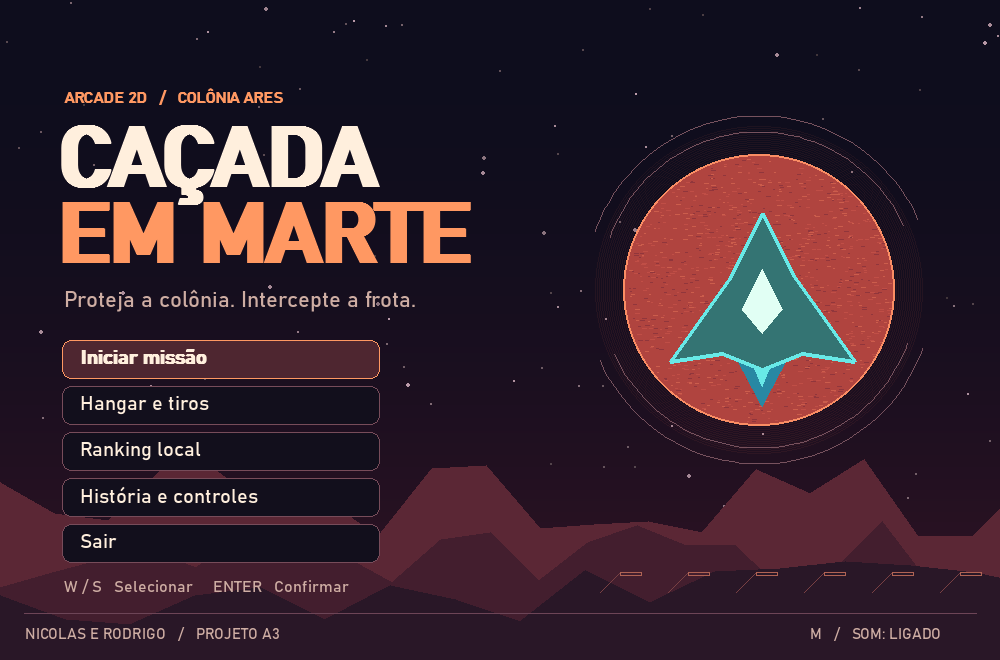
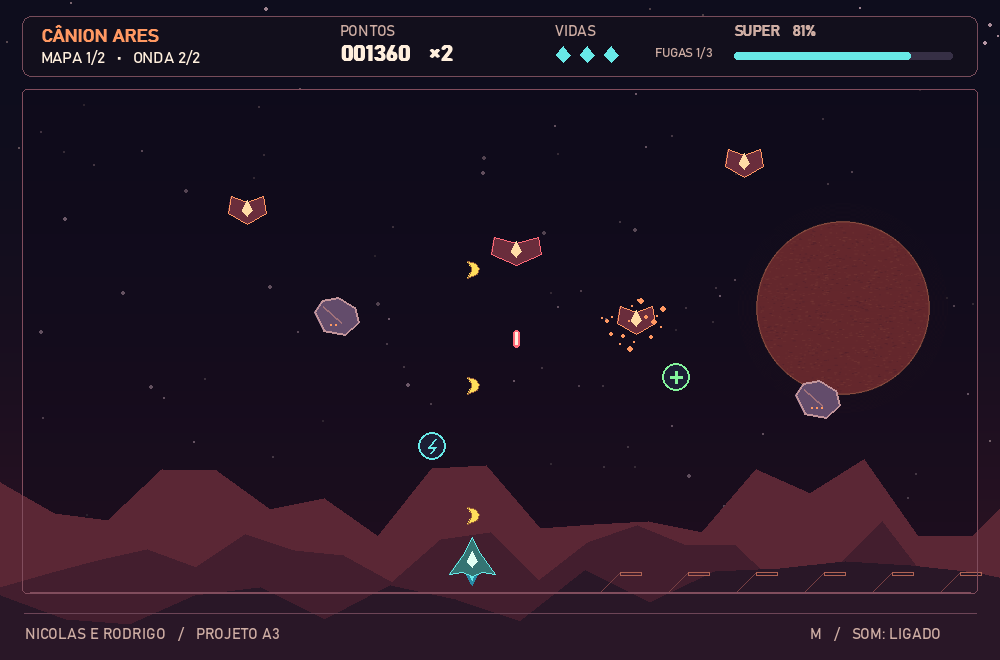
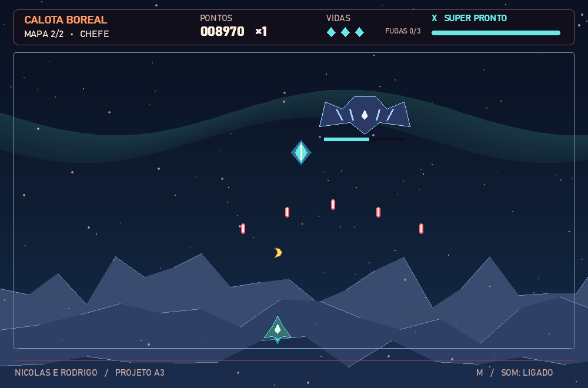
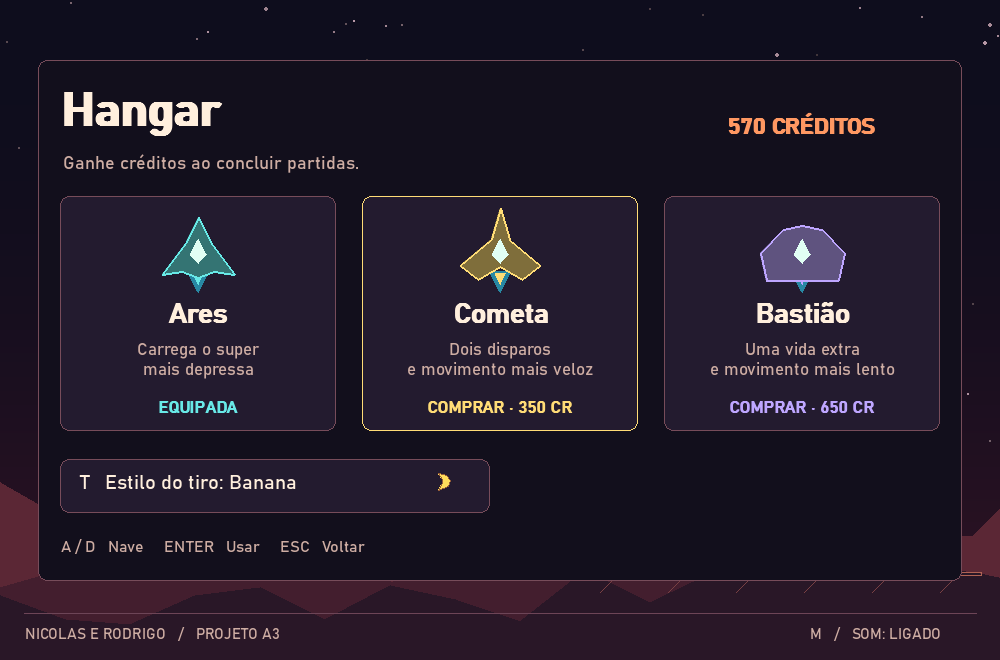

# Caçada em Marte

**Grupo:** Equipe Ares  
**Projeto:** A3  
**Disciplina:** Usabilidade, desenvolvimento web, mobile e jogos  
**Professor indicado no enunciado:** Elzo Brito dos Santos Filho

| Integrante | RA |
|---|---|
| Nicolas Cruz Peres | 82610219 |
| Rodrigo Santana Matos | 82199719 |

## Descrição

Caçada em Marte é um jogo de nave 2D com disparos, obstáculos e melhorias coletáveis.  
Em 2150, a colônia Ares perde contato com a Terra enquanto uma frota alienígena avança sobre Marte.  
O piloto atravessa o Cânion Ares e a Calota Boreal, com duas ondas e um chefe em cada mapa.  
O desempenho rende pontos para o ranking local e créditos para desbloquear naves.

## Capturas do jogo

**Menu principal**



**Cânion Ares e Calota Boreal**





**Loja de naves**



## Como jogar no Windows pelo VS Code

**Pré-requisitos:** Python 3.12, internet para a primeira instalação do Pygame e VS Code para seguir os passos abaixo. A janela do jogo abre fora do editor.

1. Extraia o ZIP inteiro. No VS Code, abra **Arquivo > Abrir Pasta** e escolha a pasta com `main.py` e `requirements.txt`. Se houver duas pastas chamadas `Cacada-em-Marte`, escolha a de dentro.
2. Abra **Terminal > Novo Terminal**. Rode `dir` para confirmar que `main.py` e `requirements.txt` aparecem. Se precisar entrar na pasta de dentro, use `cd .\Cacada-em-Marte`.
3. Rode `py -3.12 --version`. Se aparecer `No runtime installed that matches 3.12`, rode `py install 3.12` e confira a versão novamente. Se `py` estiver indisponível, use o [gerenciador oficial do Python](https://www.python.org/downloads/windows/) e reabra o terminal. Se `python --version` já mostrar Python 3.12, substitua o primeiro comando abaixo por `python -m venv .venv`.
4. Quando aparecer `Python 3.12.x`, rode estes comandos um por vez.

```powershell
py -3.12 -m venv .venv
.\.venv\Scripts\python.exe -m pip install -r requirements.txt
.\.venv\Scripts\python.exe main.py
```

Para jogar novamente, rode só o último comando na pasta que contém `main.py`. Se aparecer `No module named pygame`, instale as dependências com o segundo comando. O jogo roda offline depois de instalar o Python e o Pygame.

No macOS ou Linux, com Python 3.12 disponível, use `python3.12 -m venv .venv`, depois `.venv/bin/python -m pip install -r requirements.txt` e `.venv/bin/python main.py`.

**Teste em outro computador:** a versão inicial abriu no computador de Nicolas. A instalação da primeira versão no notebook de Rodrigo chegou a ser tentada e não foi confirmada. Para validar a entrega atual, extraia o ZIP em outro computador e repita este passo a passo. Inicie a missão, confira os controles e termine uma partida com pontuação. Feche e reabra o jogo e confira o ranking. Registre computador, versão do Python e resultado após o teste.

## Controles

| Tecla | Ação |
|---|---|
| W/S ou setas verticais no menu | Escolher uma opção |
| Enter ou Espaço no menu | Abrir a opção selecionada |
| Mouse no menu | Escolher e abrir uma opção |
| Digitação no campo do piloto | Informar o nome para o ranking |
| Backspace no campo do piloto | Apagar o último caractere |
| Enter no campo do piloto | Confirmar o nome e iniciar |
| Esc no campo do piloto, história, ranking ou loja | Voltar ao menu |
| Enter na história ou ranking | Voltar ao menu |
| A/D ou setas horizontais | Mover a nave |
| Espaço (segure) | Disparar |
| X | Usar o super quando a barra estiver cheia |
| A/D ou setas horizontais na loja | Escolher uma nave |
| Enter na loja ou clique em uma nave | Comprar ou equipar a nave selecionada |
| T na loja ou clique no estilo do tiro | Alternar entre laser, banana e cocô |
| P ou Esc durante a partida | Pausar ou retomar |
| Enter na pausa | Retomar a partida |
| Q na pausa | Voltar ao menu |
| M, fora do campo do piloto | Silenciar ou reativar o áudio |
| Enter na tela final | Jogar novamente |
| Esc na tela final | Voltar ao menu |
| Esc no menu principal | Fechar o jogo |

## Regras e progressão

**Vitória:** derrote Mandíbula Rubra e Sentinela Boreal. **Derrota:** perca todas as vidas. Ares e Cometa começam com três vidas. Bastião começa com quatro.

- Os inimigos ganham velocidade entre as ondas. Desvie de tiros e obstáculos. A cada três inimigos que escapam pela parte de baixo, sua nave pode perder uma vida. Cada mapa termina em um chefe com seu próprio padrão de ataque. Ao passar do Cânion para a Calota, recupere uma vida até o limite da sua nave.
- Eliminações e coletas de energia alimentam a barra de poder. Quando ela encher, **X** lança três projéteis perfurantes. Os estilos laser, banana e cocô mudam o visual dos tiros comuns.
- A cada três inimigos comuns abatidos, surge um item. Energia carrega o super, tiro rápido acelera os disparos por seis segundos e reparo recupera uma vida. Com as vidas cheias, o reparo vale 100 pontos.
- Batedores valem 100, guardas 200 e asteroides 30 pontos. Mandíbula Rubra vale 1.000 e Sentinela Boreal 2.000 pontos. Eliminar inimigos comuns em sequência aumenta o multiplicador até **×5**. O jogo registra resultados com pontuação e vitórias com o nome do piloto. O menu **Ranking local** mostra os dez melhores resultados.
- O jogo converte 5 pontos em 1 crédito, com 100 créditos extras pela vitória. Use os créditos na loja para desbloquear naves e selecione qual levar na próxima partida.

| Nave | Custo | Habilidade |
|---|---:|---|
| Ares | Inicial | Carrega o super mais rápido |
| Cometa | 350 créditos | Move-se mais rápido e dispara tiros duplos |
| Bastião | 650 créditos | Começa com uma vida extra e se move mais devagar |

O ranking, as naves desbloqueadas e as preferências são salvos neste computador. No Windows, o perfil fica em `%LOCALAPPDATA%\Cacada-em-Marte\perfil.json`. No macOS e Linux, o caminho padrão é `~/.local/share/Cacada-em-Marte/perfil.json`. Se `XDG_DATA_HOME` estiver definido, o jogo usa essa pasta como base.

## Divisão de tarefas

| Integrante | Contribuição registrada | Parte no ensaio |
|---|---|---|
| Nicolas Cruz Peres | Participou da definição das melhorias, executou a primeira versão no VS Code e confirmou a solução para a instalação local | Demonstrar a partida e explicar a pontuação e o super |
| Rodrigo Santana Matos | Participou da definição das melhorias e tentou instalar a primeira versão no próprio notebook | Testar o ZIP atualizado em outro computador e explicar colisões, mapas e salvamento |

Os integrantes propuseram juntos as melhorias de campanha, combate e progressão. As tarefas de ensaio são a divisão prevista para a apresentação.

## Créditos

Os integrantes propuseram o jogo e as funcionalidades. Os gráficos e o áudio são recursos originais criados para este projeto com apoio do Codex. As capturas em `assets/img/*.png` mostram a interface do próprio jogo. As trilhas `menu.wav`, `canion.wav` e `calota.wav` e os efeitos de `assets/sons/` foram sintetizados com o código de `src/marte/audio.py`. Nenhuma imagem ou faixa sonora de terceiros foi distribuída neste pacote.

| Fonte | Arquivo de origem | Autoria e condições de uso |
|---|---|---|
| Bahnschrift | `Bahnschrift.ttf` do sistema | Aaron Bell / Microsoft Typography. Fonte proprietária usada a partir do Windows. [Ficha da fonte](https://learn.microsoft.com/en-us/typography/font-list/bahnschrift) |
| Arial | `Arial.ttf` e variantes do sistema | Robin Nicholas e Patricia Saunders / Monotype. Fonte proprietária usada a partir do sistema, sem redistribuição. [Ficha da fonte](https://learn.microsoft.com/en-us/typography/font-list/arial) |
| DejaVu Sans | `DejaVuSans.ttf` e variantes do sistema | Projeto DejaVu Fonts, baseada em Bitstream Vera. [Licença DejaVu](https://dejavu-fonts.github.io/License.html) |
| FreeSans Bold | `freesansbold.ttf` do Pygame | GNU FreeFont, fonte de reserva instalada com a dependência. [Documentação do Pygame](https://www.pygame.org/docs/ref/font.html) e [licença do GNU FreeFont](https://www.gnu.org/software/freefont/FAQ.html) |

## Tecnologia e construção

**Python 3.12** e **Pygame 2.6.1** para janela, eventos, desenho 2D, colisões e áudio. A biblioteca padrão do Python oferece o JSON do perfil, a síntese de WAV com `wave` e os testes com `unittest`.

O laço principal processa as teclas, avança a simulação em pequenos intervalos e desenha o resultado. A lógica de voo, colisões, ondas e pontuação fica em `src/marte/mission.py`. A interface usa o Pygame para desenhar naves, cenários e efeitos. O perfil guarda os resultados e as compras em JSON. Os gráficos e sons são originais do projeto e foram criados por código.

```text
Cacada-em-Marte/
├── main.py               Entrada do jogo
├── requirements.txt     Dependência do Pygame
├── src/marte/            Código do jogo
├── assets/img/           Capturas e recursos visuais
├── assets/sons/          Trilha e efeitos
├── docs/                 Relatório, apresentação e roteiro
└── tests/                Testes automatizados
```

## Declaração de uso de IA

A dupla usou o **ChatGPT com Codex (OpenAI)** para transformar a proposta em protótipo, implementar grande parte da lógica e da interface, produzir os recursos originais, executar verificações e preparar a documentação. O uso está em `main.py`, `src/marte/*.py`, `tests/*.py`, `requirements.txt`, `assets/img/*.png`, `assets/sons/*.wav`, neste `README.md` e nos documentos de `docs/`, incluindo os slides. As capturas resultam da execução do jogo e os sons foram gerados pelo código. Nicolas e Rodrigo decidiram quais recursos queriam acrescentar.

A seção 6 do enunciado pede que o grupo escreva a lógica e saiba explicar o código. Esta declaração registra o que o Codex produziu. Antes de entregar, a dupla precisa consolidar sua própria implementação onde exigido e explicar como funcionam os trechos do projeto.

## Documentação e testes

- [Apresentação acadêmica](docs/APRESENTACAO_CACADA_EM_MARTE.pptx)
- [Relatório técnico](docs/RELATORIO_TECNICO.md)
- [Guia de estudo e roteiro de apresentação](docs/GUIA_DE_ESTUDO_E_APRESENTACAO.md)

Para rodar os testes no Windows, com a instalação pronta:

```powershell
.\.venv\Scripts\python.exe -m unittest discover -s tests -v
```

A versão ampliada passou em 16 testes automatizados com Windows, Python 3.12 e Pygame 2.6.1. Os testes de interface usam vídeo e áudio virtuais. A validação no notebook de Rodrigo ainda precisa ser feita com este ZIP.
